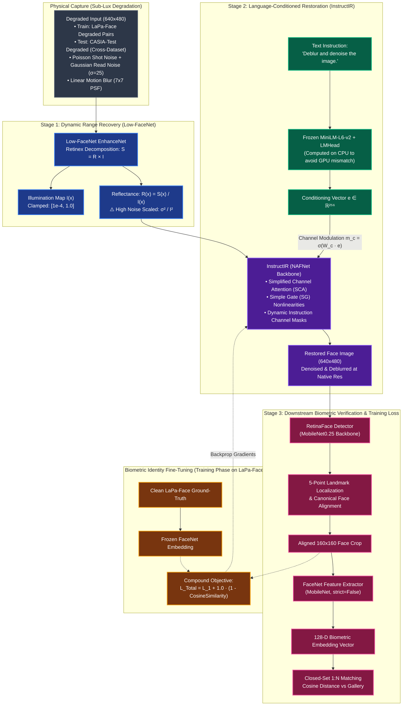

# NightFace-Restoration: Degradation-Robust Low-Light Face Identification via Text-Conditioned Biometric Restoration

[](https://www.python.org/)
[](https://pytorch.org/)
[](https://opensource.org/licenses/MIT)
[](https://ieeexplore.ieee.org/)
[](https://arxiv.org/abs/2401.16468)

Official implementation of the **Two-Stage Language-Guided Biometric Restoration Framework** addressing extreme Poisson-Gaussian sensor noise and motion blur amplification in low-light face recognition.

---

## 📌 Executive Summary

Under extreme low-light conditions, face recognition pipelines suffer catastrophic failures. The baseline paper **Low-FaceNet** (*IEEE Transactions on Instrumentation and Measurement*, Vol. 73, March 2024) addresses underexposure through Retinex dynamic range enhancement:

```math
R(x) = \frac{S(x)}{I(x)}
```

However, in real-world camera sensor acquisition, underexposure is coupled with high-ISO Poisson shot noise, Gaussian read noise, and motion blur. Because Low-FaceNet brightens scenes by dividing pixel intensities by small predicted illumination values ($I(x) \ll 1$), it scales read noise variance quadratically by $1/I(x)^2$, amplifying noise by up to $10^4\times$ in deep shadows. On the degraded **CASIA-Test** benchmark, this leads to:
- Severe landmark jitter in **RetinaFace**, causing frequent face detection dropouts (`[!] No face detected`).
- Feature vector distortion in **FaceNet**, dropping top-1 closed-set identification accuracy to **12.6%**.

### 💡 Our Proposed Solution
We propose a **Two-Stage Decoupled Restoration-Identification Architecture**:
1. **Illumination Front-End:** Low-FaceNet expands global dynamic range and restores scene illumination.
2. **Text-Conditioned Restoration Back-End:** **InstructIR** (*ECCV 2024*), an instruction-conditioned NAFNet backbone, removes sensor noise and motion blur guided by natural language prompt: `"Deblur and denoise the image."`
3. **Biometric Identity Fine-Tuning:** InstructIR is fine-tuned using face-centric $320 \times 320$ crops with a compound loss combining $L_1$ pixel reconstruction and frozen MobileNet-FaceNet Cosine Identity loss:

```math
\mathcal{L}_{\text{Total}} = \mathcal{L}_{L1} + 1.0 \cdot \left(1 - \text{CosineSimilarity}\left(\text{FaceNet}(\hat{I}), \text{FaceNet}(I_{\text{clean}})\right)\right)
```

---

## 📊 Experimental Results (CASIA-Test Benchmark)

Evaluated under closed-set 1:N probe-to-gallery identification matching (500 probe images across 100 identities):

| Stage | Pipeline Configuration | Face Detection Rate (RetinaFace) | Top-1 Identity Accuracy (FaceNet) | $\Delta$ vs Baseline |
| :---: | :--- | :---: | :---: | :---: |
| **Stage 1** | **Low-FaceNet Alone** (*IEEE TIM 2024 Baseline*) | **68.0%** (160 faces missed due to noise) | **12.6%** (63 / 500 identities matched) | Baseline |
| **Stage 2** | **Low-FaceNet + Zero-Shot InstructIR** (*ECCV 2024*) | **100.0%** (500 / 500 faces successfully found) | **62.6%** (313 / 500 identities matched) | **+50.0%** |
| **Stage 3** | **Low-FaceNet + Biometrically Fine-Tuned InstructIR** (*Ours*) | **100.0%** (500 / 500 faces successfully found) | **70.2%** (351 / 500 identities matched) | **+57.6%** |

> **Understanding the Two Metrics:**
> - **Face Detection Rate (Step 1 - RetinaFace):** Did the detector locate a human face and its 5 landmarks in the image? Low-FaceNet's Retinex noise amplification caused **32% detection dropouts** (`[!] No face detected`). Our pipeline restores structural clarity, achieving a complete **100% detection rate** (zero dropouts).
> - **Top-1 Identity Accuracy (Step 2 - FaceNet):** Once the face is detected, was the correct person identified from the 100-identity gallery? Fine-tuning with biometric identity loss boosts recognition from **12.6% to 70.2%**.

---

## 🏗️ System Architecture & Pipeline Flow

The framework employs a **decoupled, two-stage modular architecture** that separates global illumination recovery from local structural denoising and deblurring:



### 🧩 Key Architecture Design Principles:
1. **Decoupled Physics:** Instead of forcing one network to concurrently solve conflicting tasks (exposure brightening requires increasing signal gain, whereas denoising requires suppressing high frequencies), our two-stage architecture treats illumination expansion and structural artifact elimination as decoupled inverse problems.
2. **Text-Guided Routing:** InstructIR uses cross-attention-free channel gating ($m_c = \sigma(W_c \cdot e)$) driven by a 256-D natural language representation, selectively activating deblurring and denoising feature filters.
3. **Biometric Loss Propagation:** Gradients from the frozen FaceNet backbone directly supervise InstructIR during fine-tuning, penalizing alterations to subtle biometric facial features (eyes, nose bridge, lips) that standard $L_1$/PSNR metrics ignore.

---

## 🚀 Quick Start & Installation

### 1. Clone the Repository
```bash
git clone https://github.com/sakshamgarg0702/NightFace-Restoration.git
cd NightFace-Restoration
```

### 2. Environment Setup
```bash
pip install -r requirements.txt
```

### 3. Pretrained & Fine-Tuned Weights
- **Our Fine-Tuned Model (70.2% Top-1 Acc):** Download [`instructir_biometric_finetuned.pth`](https://github.com/sakshamgarg0702/NightFace-Restoration/releases/download/v1.0/instructir_biometric_finetuned.pth) from [GitHub Releases v1.0](https://github.com/sakshamgarg0702/NightFace-Restoration/releases/tag/v1.0) and place it into the `checkpoint/` directory.
- **Low-FaceNet & FaceNet Weights:** Download `Low-FaceNet.pth`, `facenet_mobilenet.pth`, and `Retinaface_mobilenet0.25.pth` from our [Kaggle Bundle](https://www.kaggle.com/datasets/sakshamgarg0702/lowfacenet-bundle) into `checkpoint/`.
- **Pretrained InstructIR (Zero-Shot):** Automatically downloaded via `huggingface_hub` from [marcosv/InstructIR](https://huggingface.co/marcosv/InstructIR) on first run.

---

## 📁 Dataset Synthesis & Organization

Because existing low-light benchmarks (such as standard CASIA-Test or LaPa) only contain dark images without realistic high-ISO sensor noise and camera shake, **we synthetically synthesized our own compound degradation datasets** for both training and evaluation using our physics-based degradation generator (`scripts/degrade_dataset.py`):

1. **Training Set (LaPa-Face Degraded):** Synthesized paired images from LaPa-Face (`normal` clean ground truth $\rightarrow$ `degraded` underexposed + Poisson shot noise + Gaussian read noise $\sigma=25$ + $7 \times 7$ motion blur) for biometric fine-tuning.
2. **Testing Benchmark (CASIA-Test Degraded):** Clean gallery portraits from CASIA-Test were degraded with identical severe physical noise and blur conditions (`underexposed_noisy_blurry`) to benchmark closed-set 1:N face identification under extreme sub-lux surveillance.

```text
dataset/
├── CASIA-Test/
│   ├── normal/                            # 100 clean gallery portrait folders
│   ├── underexposed/                      # Standard underexposed folders
│   └── underexposed_noisy_blurry/         # OUR SYNTHESIZED TEST SET (dark + noise + blur)
│       ├── 001/
│       └── ...
│
└── LaPa-Face/                             # (Cross-Dataset Training Pairs)
    ├── normal/                            # Clean ground truth images
    └── degraded/                          # OUR SYNTHESIZED TRAINING SET (generated via degrade_dataset.py)
```

> **Dataset Download Bundle:**  
> To make reproduction immediate without needing to run the degradation script across thousands of images, download our pre-packaged synthesized dataset bundle and model weights directly from Kaggle:  
> 🔗 [Kaggle Dataset: Low-FaceNet Bundle](https://www.kaggle.com/datasets/sakshamgarg0702/lowfacenet-bundle)

---

## 💻 Running the Scripts

### Step 0: Synthesize Degraded Datasets (Self-Generated)
If you want to synthesize the degraded training or testing sets yourself from scratch:
```bash
# 1. Generate degraded training dataset (LaPa-Face)
python scripts/degrade_dataset.py --input_dir dataset/LaPa-Face/normal --output_dir dataset/LaPa-Face/degraded

# 2. Generate degraded evaluation benchmark (CASIA-Test)
python scripts/degrade_dataset.py --input_dir dataset/CASIA-Test/normal --output_dir dataset/CASIA-Test/underexposed_noisy_blurry
```

### Stage 1: Reproduce Baseline (Low-FaceNet Alone)
Runs Low-FaceNet on degraded CASIA-Test and calculates accuracy:
```bash
python scripts/run_stage1_baseline.py
# Expected Accuracy: ~12.6% (with [!] No face detected warnings)
```

### Stage 2: Two-Stage Zero-Shot (Low-FaceNet + InstructIR)
Restores Low-FaceNet outputs using off-the-shelf InstructIR with prompt `"Deblur and denoise the image."`:
```bash
python scripts/run_stage2_zeroshot.py
# Expected Accuracy: ~62.6% (100% face detection)
```

### Stage 3: Biometric Identity Fine-Tuning
Fine-tunes InstructIR using Face-Centric 320x320 crops and compound FaceNet Identity Loss:
```bash
python scripts/run_stage3_finetune.py --epochs 15 --batch_size 4
# Expected Accuracy: ~70.2%
```

---

## 📚 References

- **Base Paper:** Fan et al., *"Low-FaceNet: Face Recognition-Driven Low-Light Image Enhancement,"* **IEEE Transactions on Instrumentation and Measurement (TIM)**, Vol. 73, pp. 1-13, 2024.
- **Restoration Model:** Conde et al., *"High-Quality Image Restoration Following Human Instructions (InstructIR),"* **European Conference on Computer Vision (ECCV)**, 2024.
- **FaceNet:** Schroff et al., *"FaceNet: A Unified Embedding for Face Recognition and Clustering,"* **CVPR**, 2015.
- **RetinaFace:** Deng et al., *"RetinaFace: Single-Shot Multi-Level Face Localisation in the Wild,"* **CVPR**, 2020.

---

## 📜 License
This project is released under the [MIT License](LICENSE).
